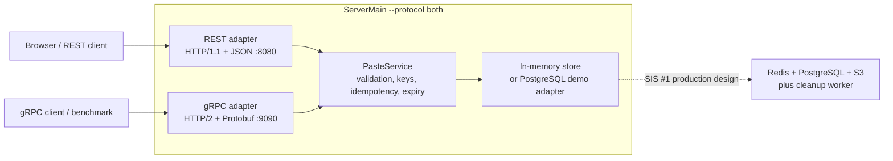
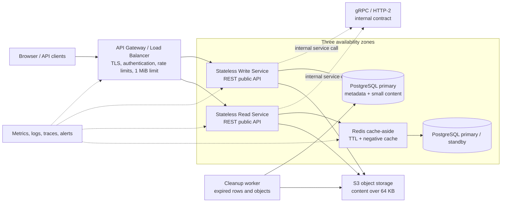
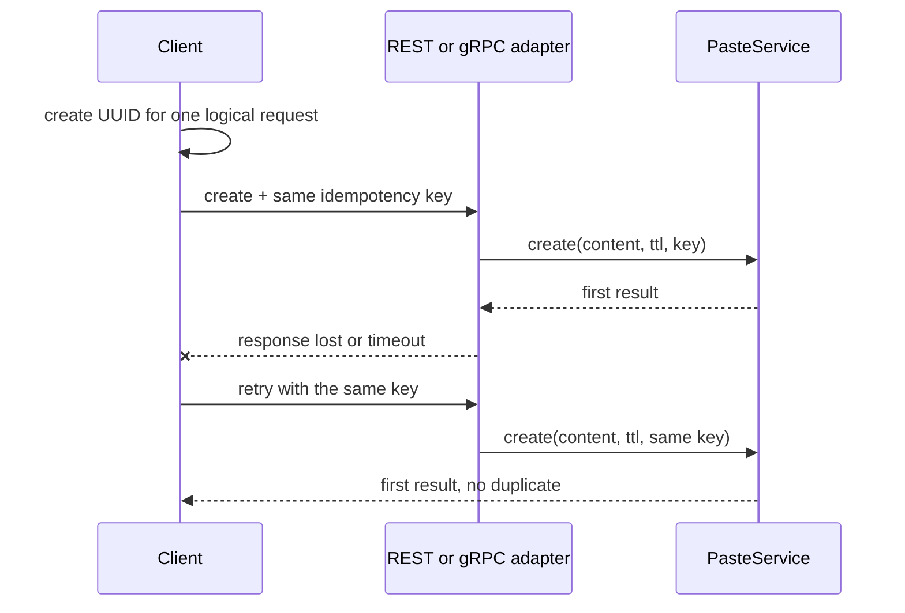

# Pastebin Protocol Implementation

This project implements the Pastebin service interface from SIS #1: create a text snippet with a TTL and read it by key. It provides a browser-friendly REST/JSON API and a gRPC HTTP/2 API over one shared service implementation. It includes idempotency, bounded retries, timeouts, PostgreSQL persistence, tests, and reproducible protocol benchmarks.

## 1. Protocol decision

The intended system design is REST/JSON for public users and gRPC for internal service-to-service calls.

gRPC is useful internally because Protobuf provides a compact typed contract, HTTP/2 supports multiplexing, metadata carries deadlines and idempotency keys, and generated clients reduce contract drift. REST remains public because browsers, scripts, and ordinary HTTP tools support it directly. WebSocket is unnecessary because Pastebin has request/response traffic and no server push.

The benchmark is deliberately honest: it compares this implementation pair, not universal protocol constants. For this text-snippet workload, gRPC's advantage is workload-dependent and modest; REST is a practical public interface.

## 2. Architecture



- Both adapters use one `PasteService`, so the protocol comparison shares business logic.
- The browser demo is REST on `http://localhost:8080/`. gRPC is available on port `9090` for native clients and benchmarks.
- PostgreSQL is an optional demo persistence adapter. Redis, S3, the gateway, and the cleanup worker from SIS #1 are not implemented here.
- PostgreSQL uses HikariCP and Flyway migration `V1__create_pastebin_tables.sql`.
- Demo servers bind to `127.0.0.1`.

### Target production architecture

The following is the complete target architecture from SIS #1. It is the design the project is moving toward, not a claim that every component is implemented in this repository.



### Current implementation versus target

| Area | Current SIS #2 implementation | Target production version |
|---|---|---|
| Public entry point | Direct localhost Netty REST server | TLS API gateway/load balancer |
| Internal protocol | gRPC adapter exists and is benchmarked | gRPC between gateway and stateless services |
| Business logic | One shared `PasteService` | Horizontally scaled stateless services |
| Persistence | In-memory store or PostgreSQL demo adapter | PostgreSQL primary/standby, Redis cache, S3 for large content |
| Idempotency | Atomic in-memory or PostgreSQL record, 24-hour retention | Idempotency helper table in the write transaction |
| Large content | Strict 1 MiB request limit; PostgreSQL demo stores content | Content above 64 KB stored in S3 |
| Expiration | Checked during reads and cleanup calls | Dedicated cleanup worker processes expired database and S3 data |
| Resilience | Bounded worker queues, retries, timeouts, localhost binding | Multi-AZ deployment, health checks, failover, rate limiting and observability |
| Evidence | JUnit tests, isolated PostgreSQL test, repeated protocol benchmarks | Requires production load, failover, security and multi-AZ validation |

The current implementation is therefore a working protocol and persistence demonstrator, while the target diagram is the complete deployable system design. The benchmark comparisons below apply only to the current adapters and stores; they do not measure the target architecture.

## 3. Idempotency, limits, timeouts, and retries



- The key is sent as REST `Idempotency-Key` or gRPC `idempotency-key` metadata.
- The same key and same request return the first result for 24 hours. The same key with different content or TTL is rejected.
- The browser demo reuses a key when content and TTL are unchanged. Editing either starts a new logical request.
- Client defaults are 200 ms per attempt, 2 seconds total, at most 3 retries, and full-jitter backoff between 0 and `min(500, 50 * 2^n)` ms.
- Creates are retried only when an idempotency key is present.
- REST and gRPC enforce a strict 1 MiB decompressed content limit and a bounded wire/request limit. Overload returns HTTP 503 or gRPC UNAVAILABLE.

| Situation | gRPC | REST | Retry |
|---|---|---|---|
| Empty text or invalid TTL | INVALID_ARGUMENT | 400 | No |
| Content over 1 MiB | OUT_OF_RANGE | 413 | No |
| Missing or expired snippet | NOT_FOUND | 404 | No |
| Same key with different request | FAILED_PRECONDITION | 422 | No |
| Temporary failure or overload | UNAVAILABLE | 503 | Yes |
| Client deadline exceeded | DEADLINE_EXCEEDED | Client timeout | Yes |

## 4. Project layout

```text
src/main/java/.../core       shared service and PostgreSQL adapter
src/main/java/.../rest       Netty REST server and client
src/main/java/.../grpc       hand-built Netty gRPC server and client
src/grpc-java/main/java      generated grpc-java server/client examples
src/main/proto               pastebin.proto contract
src/main/resources           Flyway migrations
src/test/java                 JUnit 5 and isolated PostgreSQL integration tests
results                       benchmark CSV evidence
lib                           offline runtime dependencies
```

There are two gRPC paths: the hand-built Netty adapter is the offline benchmark path, while the Maven `grpc-java` profile generates standard stubs from the same `.proto`. The final REST comparison uses the Netty REST server so both protocol adapters use the same server framework.

## 5. Run locally

Requirements: JDK 21. Maven is optional; IntelliJ's bundled Maven works.

### Browser demo with PostgreSQL

Set `POSTGRES_PASSWORD` in the IntelliJ `ServerMain` environment variables. The password is intentionally not stored in the run configuration or program arguments.

Run `kz.kbtu.pastebin.ServerMain` with:

```text
--grpc-port 9090 --rest-port 8080 --threads 16 --postgres-url jdbc:postgresql://localhost:5432/pastebin --postgres-user postgres
```

Open `http://localhost:8080/`. Enter text and click **Create snippet**. The returned link opens `/p/{key}`. Missing snippets return HTTP 404.

For in-memory mode, omit the PostgreSQL arguments. To run only one protocol, add `--protocol rest` or `--protocol grpc`; the default is `both`.

### Offline build

```bash
./build.sh
./run_tests.sh
./run_server.sh
```

On Windows, the equivalent server command is:

```powershell
java -cp 'target/classes;lib/*' kz.kbtu.pastebin.ServerMain --protocol both --grpc-port 9090 --rest-port 8080 --threads 16
```

### Maven and generated grpc-java

```text
mvn -Pgrpc-java clean test
```

The `grpc-java` profile is active by default when Maven is imported. It generates sources under `target/generated-sources/protobuf/java` and `target/generated-sources/protobuf/grpc-java`. The generated smoke main is `kz.kbtu.pastebin.grpcjava.GrpcJavaSmokeMain`.

If IntelliJ does not recognize `src/grpc-java/main/java`, mark that directory as a Sources Root; do not move the files.

The PostgreSQL integration test is opt-in and creates a random isolated schema:

```text
mvn -Pgrpc-java -Dpostgres.integration=true -Dpostgres.url=jdbc:postgresql://localhost:5432/postgres -Dpostgres.user=postgres -Dpostgres.password=<local-password> -Dtest=PostgresPasteServiceIntegrationTest test
```

## 6. Tests and benchmarks

The test suite covers 33 individual scenarios plus focused service tests and the optional PostgreSQL integration test. It covers validation, idempotency, concurrent duplicate requests, retries, lost responses, timeouts, errors, gzip, 1 MiB payloads, both protocols, and Protobuf compatibility.

Benchmark modes are `latency`, `bytes`, `throughput`, `mixed`, and `reliability`:

```text
java -cp "target/classes;lib/*" kz.kbtu.pastebin.bench.Benchmark throughput --host 127.0.0.1 --grpc-port 9090 --rest-port 8080 --out results/run
java -cp "target/classes;lib/*" kz.kbtu.pastebin.bench.Benchmark mixed --host 127.0.0.1 --grpc-port 9090 --rest-port 8080 --repeats 5 --out results/mixed-repeated
```

The mixed workload is 80% GET 1 KB, 15% GET 64 KB, and 5% POST 1 KB. Each worker has its own client connection and deterministic random stream. Report medians, not a single best run.

## 7. Final measurements

The final in-memory throughput table uses five complete runs, eight workers, and the median requests per second:

| Operation | gRPC median | REST median | Errors |
|---|---:|---:|---:|
| GET 1 KB | 29,485 | 27,076 | 0 / 0 |
| POST 1 KB | 22,849 | 21,271 | 0 / 0 |
| GET 64 KB | 5,822 | 9,928 | 0 / 0 |

The 64 KB result shows REST ahead in this implementation. Therefore the project does not claim a universal throughput winner.

The preliminary five-run PostgreSQL mixed benchmark, including HikariCP and SQL persistence costs, measured 13,834 req/s for gRPC and 12,255 req/s for REST, with zero errors. It is not directly comparable to the in-memory table.

The TLS run used a local self-signed PKCS12 certificate with `localhost` and `127.0.0.1` SANs. It measured, in one run, 25,569/25,239 req/s for REST/gRPC 1 KB GET, 21,823/24,653 for POST, and 8,829/5,301 for 64 KB GET, all with zero errors. These are TLS measurements, not repeated confidence intervals.

Raw evidence is in `results/repeated-throughput-summary.csv`, `results/postgres-throughput/`, `results/postgres-mixed-repeated/`, and `results/tls-throughput/`. The complete report is at `../../Pastebin_SIS2_Report.docx` relative to this project directory.

## 8. Limitations

- Measurements use localhost and a small two-CPU machine; they do not prove the SIS #1 production p99 target.
- PostgreSQL is a demo adapter, not the Redis/PostgreSQL/S3 production design from SIS #1.
- TLS results are single-run evidence; the in-memory throughput table is the repeated baseline.
- The generated grpc-java path is validated by Maven tests and has a separate smoke/benchmark path; the main historical comparison uses the hand-built Netty gRPC adapter.
- The browser demo is REST. Browsers do not call the gRPC port directly.
